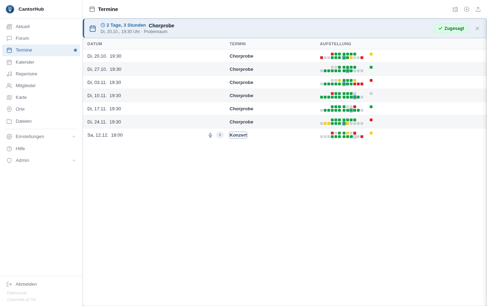
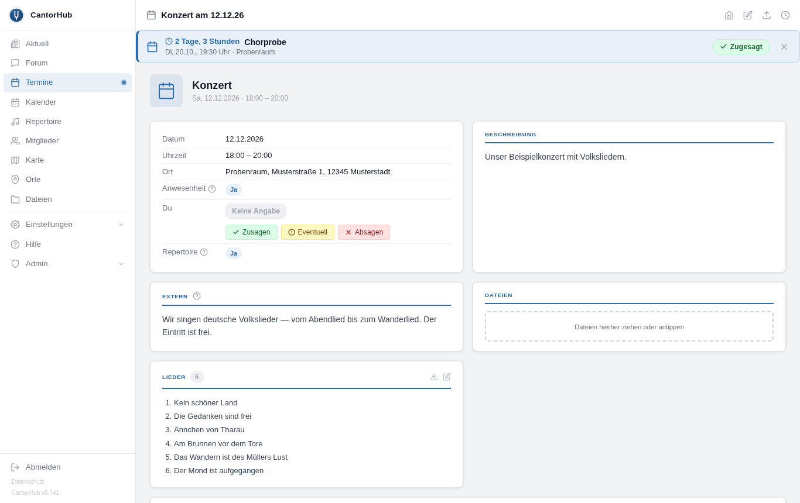
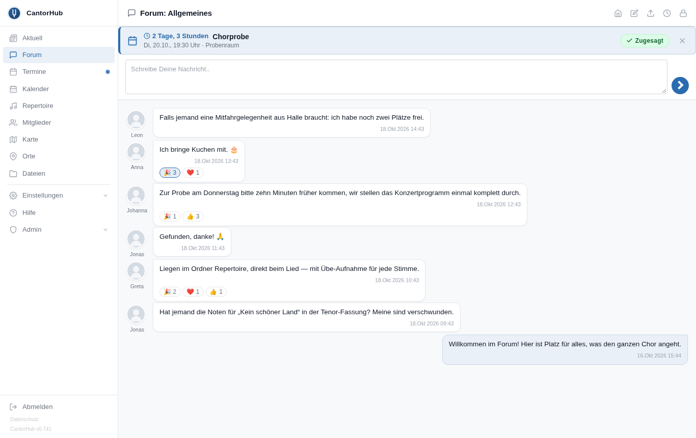
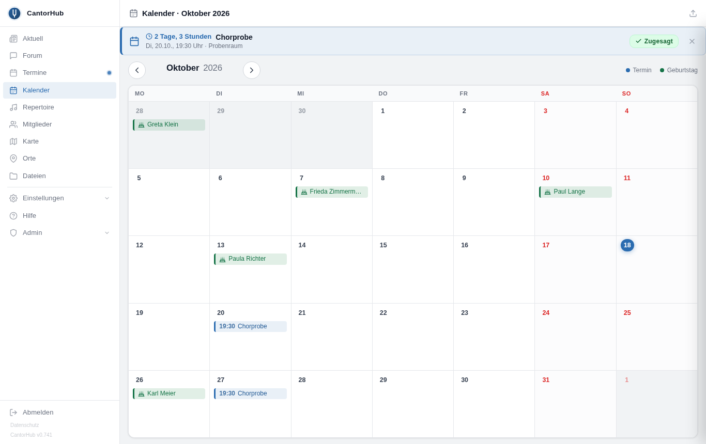
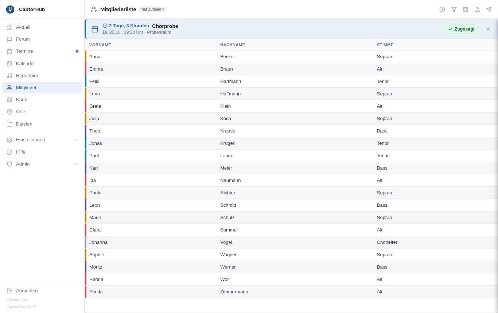
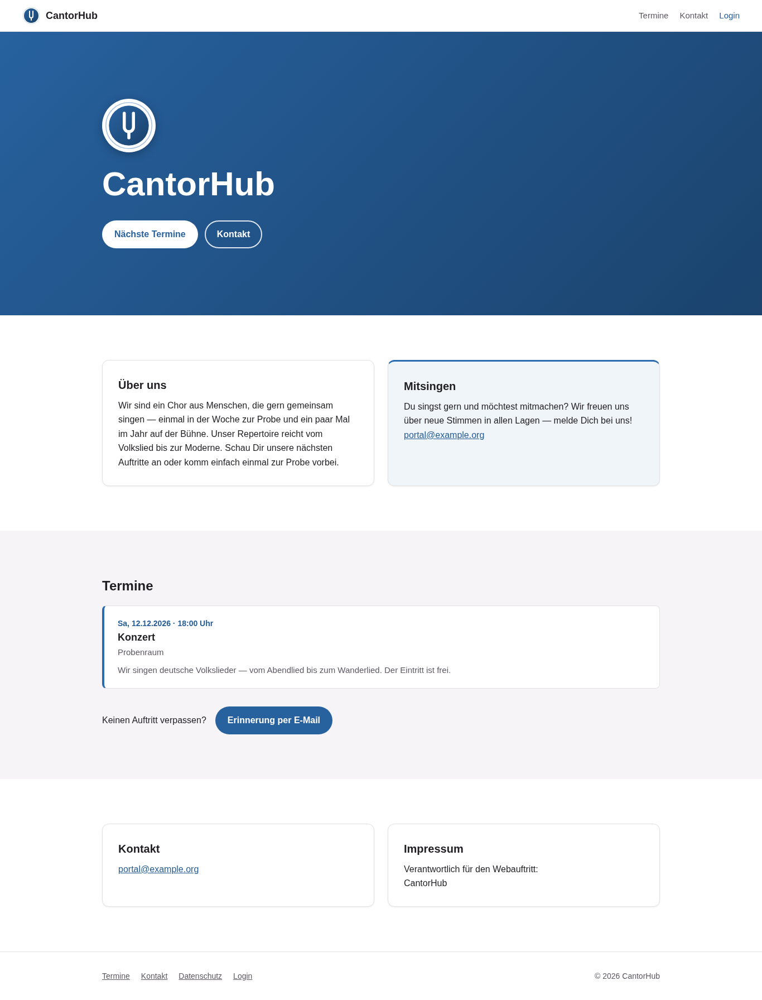
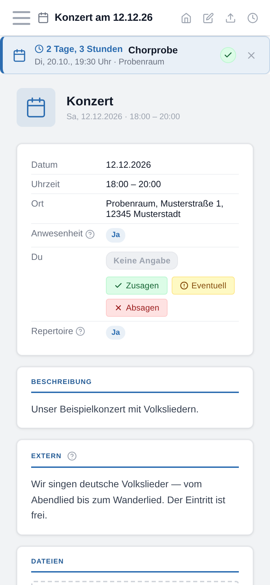
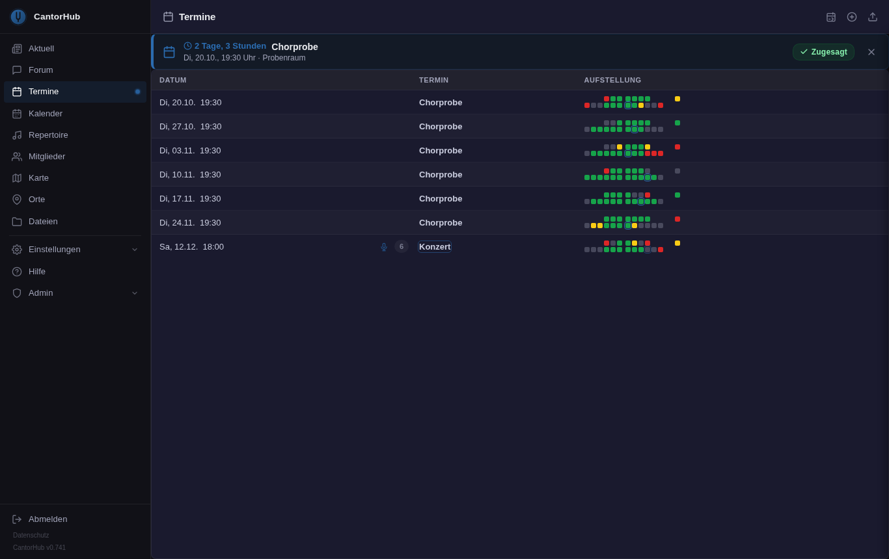

# CantorHub

**The website for your choir — a public homepage and a members' area in one, started with a
single command.**

Rehearsals and concerts with attendance at a glance, the repertoire with sheet music and
practice recordings, a forum, a wiki and a file archive — on your own server, under your own
name. The portal speaks German throughout.



## Try it in one minute

With [Podman](https://podman.io/) or Docker installed, one command starts it:

```bash
podman run -d -p 8000:8000 -v cantorhub-data:/data ghcr.io/hgruber/cantorhub:latest
```

Then open **<http://localhost:8000>** on the same machine. A single page asks for the first
account and the address of the portal; tick „Beispieldaten anlegen“ and you get rehearsals, a
concert with its running order, a few songs and a forum to click through. That is the whole
installation. The same image runs on a PC, a server and a 64-bit Raspberry Pi.

> Open it as `localhost` or over `https://`. Called by its bare IP address over `http://`
> (`http://192.168.1.129:8000`), the browser refuses the login cookie and the setup ends in a
> CSRF error. To try it on a Raspberry Pi from your desktop, tunnel the port:
> `ssh -L 8000:localhost:8000 pi@<address>`, then open `http://localhost:8000`.

There is no public demo site on purpose — a portal anyone may set up and log into is a security
risk we would rather not run. Your own copy is one command away and gone again with
`podman rm -f` and `podman volume rm cantorhub-data`.

## What your choir gets

<table>
<tr>
<td width="50%"></td>
<td width="50%"></td>
</tr>
<tr>
<td><b>Events</b> — rehearsals, concerts and gigs; every member answers yes, maybe or no,
and everyone sees the line-up per voice before the day. Concerts carry their running order.</td>
<td><b>Forum</b> — threads with emoji reactions and unread markers; optionally bridged to XMPP
chat rooms, so members can follow it in a messenger app.</td>
</tr>
<tr>
<td></td>
<td></td>
</tr>
<tr>
<td><b>Calendar</b> — month grid with events and birthdays; subscribe to it on the phone via
CalDAV or an iCal link.</td>
<td><b>Members</b> — voice, address and photo; every member decides which fields others see.
Joining by invitation link, leaving and re-confirmation are built in.</td>
</tr>
</table>

And besides:

- **Repertoire** — songs with key, tempo, sheet music, recordings and a player.
- **Files** — a folder archive with per-group rights, previews, full-text search and version
  history.
- **Wiki** — versioned articles with history; help pages for members ship with it.
- **Public homepage** with your upcoming gigs, and a reminder mailing list with double opt-in
  for your audience. Replace the shipped page with your own whenever you like.
- **Phone sync** — the member list as an address book (CardDAV) and the events as a calendar
  (CalDAV), both switched off until you turn them on.
- **Your look** — name, logo and accent colour are settings, not code.
- Light and dark theme, made for phones as much as for the desktop.

<table>
<tr>
<td width="36%"></td>
<td width="32%"></td>
<td width="32%"></td>
</tr>
<tr>
<td>The public homepage</td>
<td>On the phone</td>
<td>Dark theme</td>
</tr>
</table>

## Trying it is easy — running it takes a little care

Starting CantorHub needs no know-how beyond installing Podman or Docker. Running it **for your
choir's real data** is a different matter, and we would rather say so up front. Someone in the
choir should be comfortable with a terminal for an afternoon and willing to look after it now
and then. They will need:

- **A machine that stays on** — a small rented server or a Raspberry Pi at home.
- **A domain and HTTPS** in front of the portal, e.g. a reverse proxy with a Let's Encrypt
  certificate. Without it, passwords travel in plain text.
- **A mail account** the portal may send from — for invitations, password resets and gig
  reminders.
- **Backups** of the data volume (and of the database, if you use MariaDB instead of the
  built-in SQLite).
- **Updates** — pull the new image and restart; the database is migrated on start.

All of this is described step by step in [INSTALL.md](INSTALL.md). Once it runs, the daily work
— members, events, texts, mail templates, name and colours — happens in the browser.

## Documentation

| | |
|---|---|
| [INSTALL.md](INSTALL.md) | Installation, configuration, updates, backups, troubleshooting |
| [CHANGELOG.md](CHANGELOG.md) | What changed in each version |
| [CLAUDE.md](CLAUDE.md) and [docs/](docs/) | For developers: code map, invariants, topic documents |

## License

[MIT](LICENSE). Built with Django.
